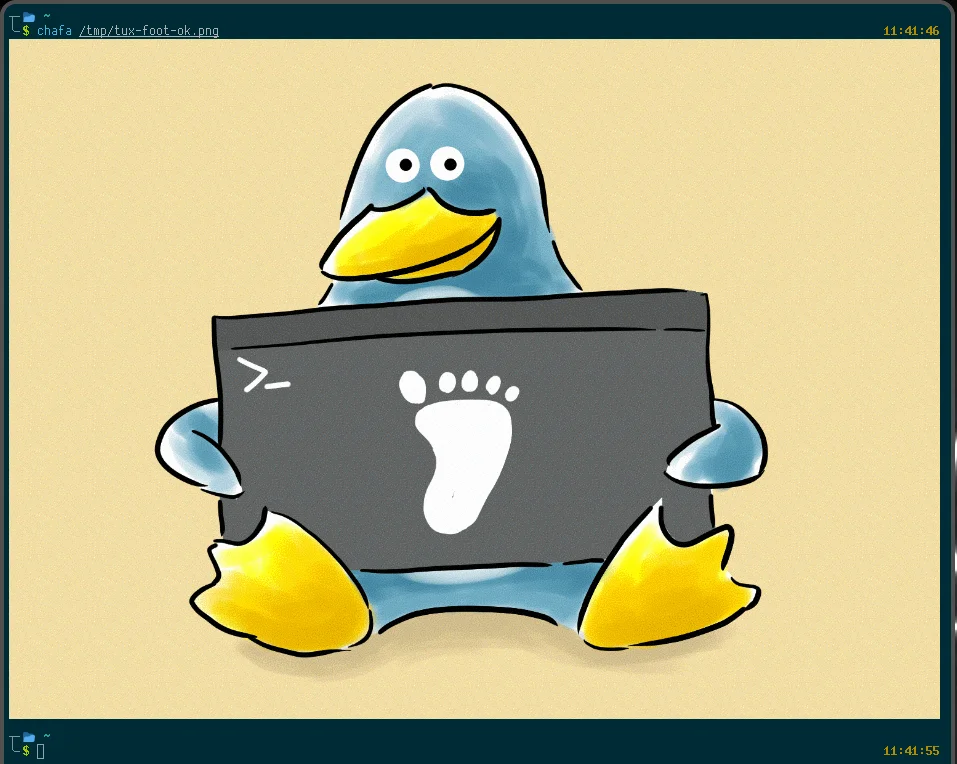

RK3588 上使用 Ghostty 不支持 GPU 加速渲染，于是寻找更轻量的 wayland 终端模拟器。

通过搜索发现了 [foot](https://codeberg.org/dnkl/foot)，这是一个使用 c 语言编写的终端模拟器，支持[许多特性](https://codeberg.org/dnkl/foot#features)。

- Fast (see benchmarks, and performance)
- Lightweight, in dependencies, on-disk and in-memory
- Wayland native
- On-the-fly font resize
- On-the-fly DPI font size adjustment
- Scrollback search
- Keyboard driven URL detection
- Color emoji support
- IME (via text-input-v3)
- True Color (24bpp)
- Styled and colored underlines
- Synchronized Updates support
- Sixel image support
- ...




***


然后配置了一下字体和一些主题、窗口设置。

<details>
<summary>配置文件(\~/.config/foot/foot.ini)</summary>

```ini
# -*- conf -*-
include=/usr/share/foot/themes/dracula

# shell=$SHELL (if set, otherwise user's default shell from /etc/passwd)
# term=foot (or xterm-256color if built with -Dterminfo=disabled)
# login-shell=no
# title=foot

font=JetbrainsMono NF:size=11
line-height=15
# letter-spacing=0
initial-window-size-chars=90x26
# initial-window-mode=windowed
# pad=0x0 center-when-maximized-and-fullscreen
pad=8x8

[environment]
# name=value

[security]
# osc52=enabled  # disabled|copy-enabled|paste-enabled|enabled

[bell]
# system=yes
# urgent=no
# notify=no
# visual=no
# command=
# command-focused=no

[scrollback]
lines=3000
# multiplier=3.0
# indicator-position=relative
# indicator-format=""

[cursor]
style=beam

[csd]
preferred=client
color=ff282a36
button-color=ffffffff

[key-bindings]
fullscreen=F11
```

</details>
